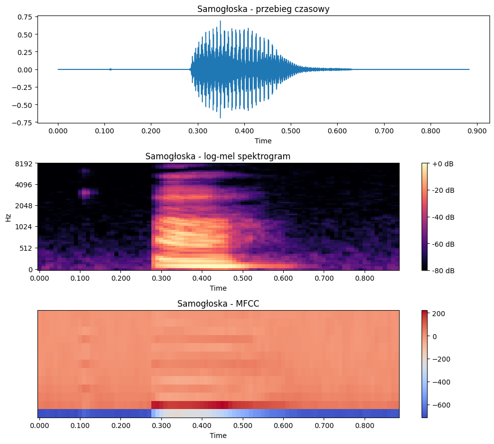
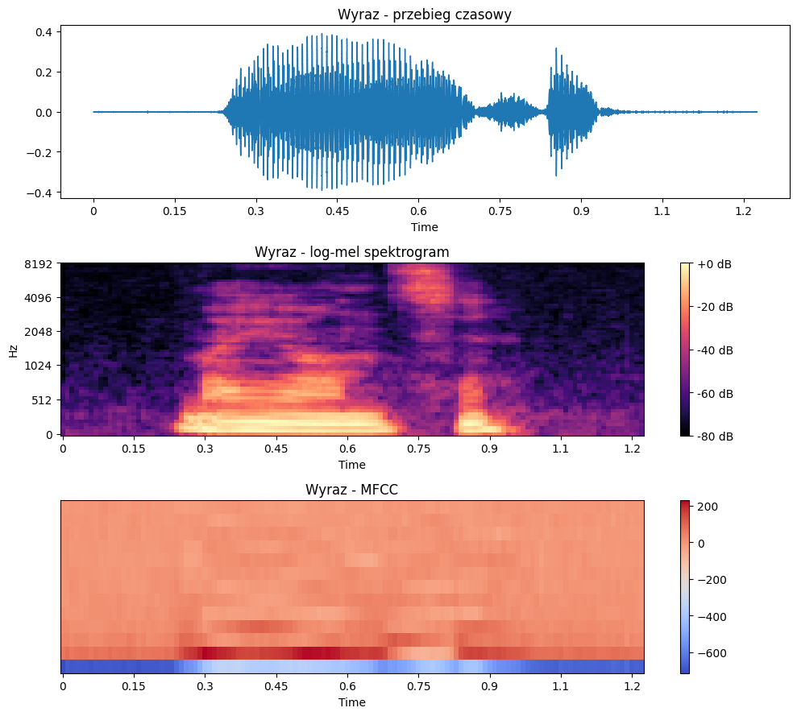
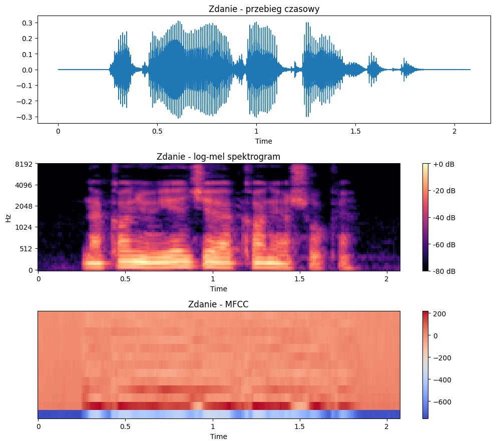
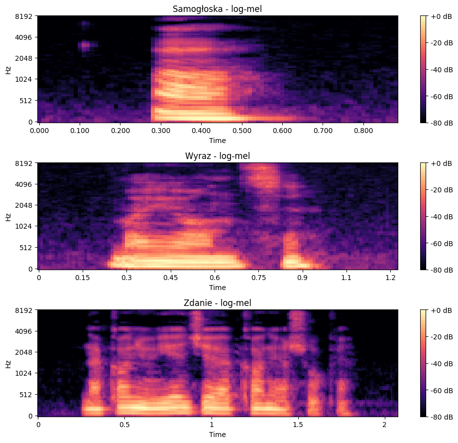
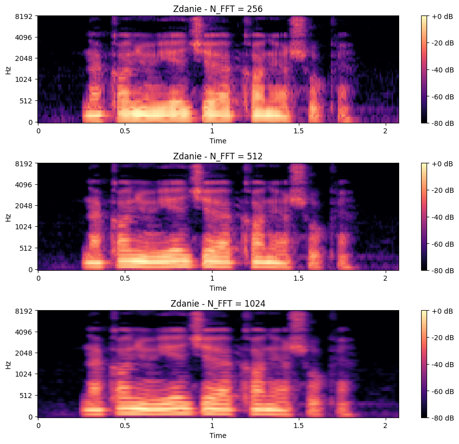
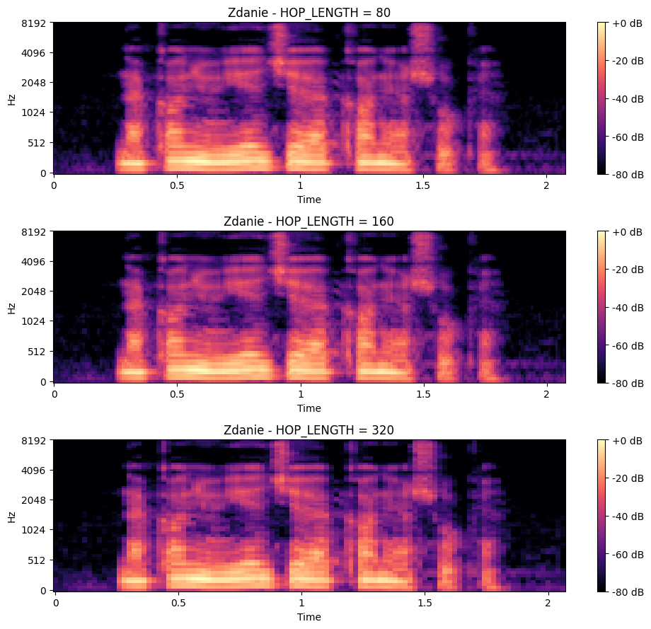

# Sprawozdanie 1

**Przedmiot:** Uczenie głębokie w systemach rozpoznawania i przetwarzania mowy  
**Zajęcia nr / temat:** 1 – Sekwencje i sygnał mowy: od fali dźwiękowej do reprezentacji  
**Autor / grupa:** Jakub Wierzchowiak / grupa 4  
**Data:** 19.10.2026

## 1. Cel ćwiczenia

Celem ćwiczenia była analiza trzech nagrań mowy (samogłoski, wyrazu i zdania) oraz porównanie ich reprezentacji: przebiegu czasowego, log-mel i MFCC. Zbadano również wpływ parametrów `n_fft` i `hop_length` na spektrogram.

## 2. Metoda i implementacja

Ćwiczenie wykonano w Google Colab z wykorzystaniem bibliotek `librosa`, `numpy` i `matplotlib`.

Wykorzystano trzy nagrania WAV z Wikimedia Commons:
- Samogłoska „a”.
- Wyraz „mający”.
- Zdanie „Na koniu jedzie, a konia szuka”.

Nagrania wczytano do 16 kHz mono.

**Parametry początkowe:**

| Parametr | Wartość |
|---|---|
| SR | 16000 Hz |
| N_FFT | 512 |
| HOP_LENGTH | 160 |
| N_MELS | 64 |
| MFCC | 13 współczynników |

Do analizy wykorzystano funkcje `librosa.feature.melspectrogram()`, `librosa.power_to_db()` i `librosa.feature.mfcc()`.

## 3. Wyniki

### 3.1. Parametry nagrań

| Nagranie | Czas | Liczba próbek | Log-mel | MFCC |
|---|---|---|---|---|
| Samogłoska | 0,88 s | 14123 | (64, 89) | (13, 89) |
| Wyraz | 1,22 s | 19584 | (64, 123) | (13, 123) |
| Zdanie | 2,08 s | 33238 | (64, 208) | (13, 208) |

### 3.2. Wizualizacja nagrań

**Samogłoska „a”**

**Wyraz „mający”**

**Zdanie „Na koniu jedzie, a konia szuka”**

### 3.3. Porównanie log-mel

Samogłoska ma najprostszy przebieg, natomiast wyraz i zdanie zawierają więcej zmian energii oraz częstotliwości.

### 3.4. Wpływ n_fft

Porównano `n_fft = 256, 512, 1024` przy stałym `hop_length = 160`.

Mniejsze okno lepiej lokalizuje zmiany w czasie, a większe poprawia rozdzielczość częstotliwościową.

### 3.5. Wpływ hop_length

Porównano `hop_length = 80, 160, 320` przy stałym `n_fft = 512`.

| HOP_LENGTH | Liczba ramek |
|---|---|
| 80 | 416 |
| 160 | 208 |
| 320 | 104 |

Wraz ze zwiększaniem `hop_length` liczba ramek maleje.

## 4. Analiza i interpretacja

Samogłoska ma jeden główny fragment o dużej amplitudzie, wyraz zawiera kilka różnych fragmentów, a w zdaniu widoczne są dodatkowo przerwy między słowami.

Log-mel przedstawia rozkład energii w pasmach częstotliwości, natomiast MFCC opisuje kształt widma za pomocą 13 współczynników.

Zmiana `n_fft` wpływa na rozdzielczość czasową i częstotliwościową. Z kolei mniejszy `hop_length` zwiększa liczbę ramek, dzięki czemu sygnał jest analizowany częściej.

## 5. Wnioski

Ćwiczenie pokazało różnice między reprezentacjami samogłoski, wyrazu i zdania. Dłuższe wypowiedzi mają bardziej złożoną strukturę i więcej zmian w czasie.

Log-mel pozwala obserwować rozkład energii, a MFCC przedstawia cechy sygnału w bardziej zwartej formie. Dobór `n_fft` i `hop_length` wpływa na szczegółowość analizy mowy.